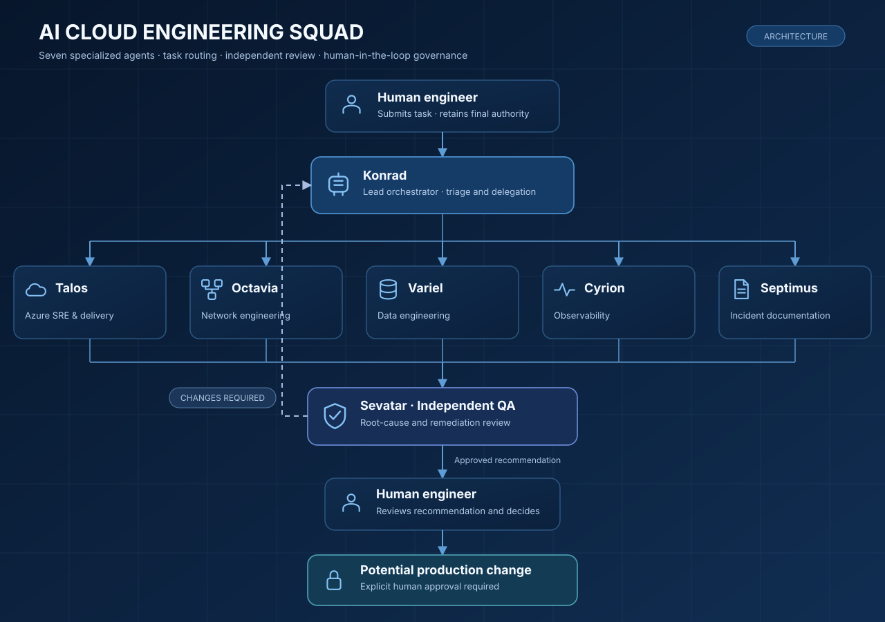

# ⚔️ AI Cloud Engineering Squad
### Multi-Agent Orchestration | Microsoft Azure | Cloud Security | Human-in-the-Loop Review

> **Portfolio project by Mark Culberson** — A configured seven-specialist AI Squad supporting Azure, Azure DevOps, and GitHub engineering workflows. This repository documents configuration and an observed read-only agent collaboration test; it is **not** evidence of autonomous production deployment or a custom-built agent runtime.

## Project overview
I configured a domain-specialized Squad with task-routing instructions, a lead orchestrator, independent review, and explicit human approval gates. The aim is to apply AI-assisted engineering to incident triage, cloud infrastructure troubleshooting, and secure delivery while keeping the human operator accountable.

**Demonstrated:** a read-only Azure VM quota diagnostic exercise that routed investigation to Talos, requested Sevatar's independent review, received **CHANGES REQUIRED**, assigned revisions to Konrad, and received **APPROVED** on re-review. The suspected quota cause was **not independently confirmed**; no Azure resources were changed.

## Architecture

This is a **conceptual rendering of documented routing policy**; it does not imply every branch ran in the demonstration.

## Seven active specialists

| Agent | Configured responsibility |
|---|---|
| **Konrad** | Lead orchestrator; incident triage, scope, coordination, handoffs |
| **Talos** | Azure SRE and delivery; Azure services, quotas, policy, CI/CD |
| **Octavia** | Azure networking; VNets, DNS, Private Link, firewall, connectivity |
| **Variel** | Azure data engineering; data services, storage, backup and migration |
| **Cyrion** | Azure observability; Azure Monitor, telemetry, alerts, KQL |
| **Septimus** | Incident documentation; timelines, postmortems, work tracking |
| **Sevatar** | Independent QA and reviewer; security checks and readiness |

Additional built-in support roles documented in the source setup: Scribe (decision merger), Ralph (work monitor), Rai (RAI reviewer), Fact Checker (verification). `@copilot` is listed separately as a coding agent with automatic assignment disabled.

## Routing and safeguards
- A single accountable owner for each task; independent evidence-gathering can run in parallel.
- Active incidents begin with Konrad, Talos, Cyrion, and Septimus; other domain specialists join as evidence warrants.
- Sevatar independently reviews proposed incident root causes and remediation.
- Production-changing commands require the human lead's explicit approval.
- Read-only investigation is the default; confirm the correct Azure tenant/subscription and repository context before commands.
- The project documents GitHub Issue label conventions, but does **not** claim a production issue automation was executed.

## Observed demo: Azure VM regional vCPU quota

**Prompt:** Investigate a user-reported regional vCPU quota failure without modifying resources.

1. Coordinator identified Talos as domain owner and Sevatar as reviewer.
2. Azure-related read-only tools were invoked; exact deployment region, VM SKU, core count and error were missing.
3. Talos investigated plausible quota mechanics; some agent launch attempts failed and some shell/tool approvals were denied.
4. Sevatar requested corrections to the confidence statement and quota comparison.
5. Konrad revised the handoff; Sevatar approved the revised recommendations.

**Outcome:** A reviewed, qualified troubleshooting recommendation — **not** confirmation of the actual quota failure and **not** remediation of Azure infrastructure.

See [case study](examples/azure-vm-quota-case-study.md) and [sanitized transcript](examples/azure-vm-quota-sanitized.txt).

## What I learned
- Agent role design and routing rules are different from proving autonomous execution.
- Independent review can catch overconfident technical claims.
- Both **regional total vCPU quota** and **VM-family vCPU quota** matter for deployment feasibility.
- Approval gates and missing environment context must be reported, not bypassed.

## Repository contents
- [`docs/architecture.md`](docs/architecture.md): design and observed-vs-configured boundaries
- [`docs/agents.md`](docs/agents.md): specialist roster and support agents
- [`docs/security.md`](docs/security.md): public-sharing and operational safety
- [`examples/`](examples/): redacted demonstration and case study
- [`evidence/`](evidence/): screenshots of configuration and routing (review before publication)
- [`docs/validation.md`](docs/validation.md): verification checklist and known gaps

## Reproducing the demonstration
The original setup used a locally configured Squad integration with GitHub Copilot in VS Code. This packet is a **documentation portfolio**, not a turnkey redistribution of that framework. To reproduce, install an appropriately licensed Squad framework, configure your own agents and tools, and run the read-only scenario in your own authorized environment. No secrets or live credentials are provided.

## Scope and attribution
The Squad framework and generated scaffolding may be third-party materials. This repository documents **my configuration, test observations, and analysis**. The packet does not include original framework source or assert that I authored its runtime. Review the underlying framework's redistribution license before publishing agent charters or templates.

## Next improvements
- Add independently verified repeatable setup instructions after licensing review.
- Capture a clean second demonstration with known test inputs and successful permission prompts.
- Add validation tests for routing, review gates, and sanitized logging.
- Create a small isolated example showing a full end-to-end engineering workflow.

**Status:** Portfolio documentation assembled; public release pending final review.
